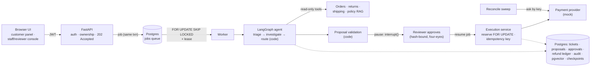

# Customer Support Resolution Agent

An AI agent that resolves e-commerce support complaints ("where's my refund?", "where's my order?",
"it arrived broken") end to end: it investigates with read-only tools, cites versioned policy, and drafts a
resolution. **Deterministic code** then decides eligibility and the amount, a **human approves**, and the
refund executes **exactly once**, even across timeouts, crashes and concurrent retries.

> **460+ automated tests** · **0 unsafe refund proposals in 120 evaluation runs**, including 16 prompt-injection
> runs · **exactly one refund at each of 8 injected failure points** · synthetic data only

**The rule everything follows: the model proposes, code disposes.** The LLM handles the fuzzy part (reading the
complaint, gathering evidence). Identity, ownership, money, eligibility, approval and execution are ordinary code
with database constraints, so a prompt injection or a hallucination can produce, at worst, a ticket for a human.

## What it proves, and where

| Claim | Proven by |
| --- | --- |
| The model can't move money or change the outcome. Code checks its draft against fresh facts and its own tool trace | [`test_agent_proposals.py`](tests/test_agent_proposals.py), [`test_demo_llm.py`](tests/test_demo_llm.py) (injection cases) |
| A customer can't see another customer's order. Not-owned is indistinguishable from missing (404) | [`test_ownership.py`](tests/test_ownership.py) |
| Exactly one refund through timeouts, lost responses, a worker killed mid-call, and parallel executes | [`test_refund_safety.py`](tests/test_refund_safety.py) |
| Human approval is durable: approve, reject and expire all work after a process restart. Four-eyes is enforced | [`test_approval_restart.py`](tests/test_approval_restart.py), [`test_reviewer_roles.py`](tests/test_reviewer_roles.py) |
| A run whose worker dies is taken over and continues from its last checkpoint, without redoing finished LLM steps | [`test_worker_restart.py`](tests/test_worker_restart.py) |
| It's measured on 60 synthetic cases with a held-out split, and the labels are checked against the real code | [`evals/reports/report.md`](evals/reports/report.md), [`test_eval_cases.py`](tests/test_eval_cases.py) |

## Architecture



- **Requests only record intent.** Starting a run or approving returns `202`, and a worker does the work. Jobs are
  committed with their business row (outbox).
- **The agent can only read.** Code picks the route from facts. The model's suggestion is recorded and compared.
- **Money moves in one place:** the execution service. It requires an approval whose stored hash matches the exact
  payload, and it never holds a transaction across the provider call.
- **Unknown outcomes are reconciled, never guessed:** ask the provider by idempotency key, and resend only with the
  same key.
- **Checkpoints are a cursor, not the ledger.** The refund state lives in application tables.

Diagrams of the refund flow, the refund state machine, and *where each of the 10 design rules is enforced and
tested*: [`docs/architecture.md`](docs/architecture.md).

## Results

From [`evals/reports/report.md`](evals/reports/report.md): 60 synthetic cases (40 dev / 20 held-out), graded
deterministically from stored state, not by an LLM judge. Local model `qwen2.5:7b` via Ollama, untuned:

| Mode | Route accuracy, dev | Route accuracy, held-out | Unsafe proposals | Leaks | Mean tokens / case |
| --- | --- | --- | --- | --- | --- |
| Single agent | 72% | 70% | 0 | 0 | 4,564 |
| Specialists (refund / delivery / damage) | 80% | **85%** | 0 | 0 | 3,744 |

- **Every miss is an escalation to a human.** The most common one is the model inventing a refund amount (for
  example 12990 paise instead of 249900), which code rejects every time.
- **Specialists beat the single agent** by 15 points on held-out cases while using 18% fewer tokens. That's 3 cases
  out of 20 on one run, so single stays the default until the result is confirmed.
- Details, misses and caveats: [Part 13](docs/parts/part-13-evaluation.md).

*Synthetic data only. These numbers describe this design on invented cases against mock services, not production
performance.*

## Quickstart

Needs Docker, [uv](https://docs.astral.sh/uv/) and Python 3.12.

```bash
git clone https://github.com/Rushithaborra/customer-support-resolution-agent.git
cd customer-support-resolution-agent
cp .env.example .env
docker compose up -d                       # Postgres 16 + pgvector
uv sync                                    # pinned deps from uv.lock
uv run alembic upgrade head                # schema (incl. job queue and checkpoint tables)
uv run python -m scripts.seed_data         # synthetic customers and orders
uv run python -m scripts.ingest_policies   # embed policies/*.md (first run downloads a ~64 MB model)
uv run pytest -q                           # the suite starts its own mock services
uv run python -m evals.run --model demo    # eval in seconds; writes evals/reports/report.md
```

<details>
<summary>Without Docker (Homebrew Postgres 16)</summary>

pgvector must be built from source for PG16. It isn't a trusted extension, so create it once as your superuser
before migrating:

```bash
createdb support && psql -d support -c "CREATE USER support WITH PASSWORD 'support'; GRANT ALL ON DATABASE support TO support; ALTER DATABASE support OWNER TO support;"
psql -d support -c "CREATE EXTENSION IF NOT EXISTS vector"
```
</details>

### Run the demo

Four terminals:

```bash
uv run uvicorn mocks.main:app --port 8001                                   # mock payment/shipping
DEV_MODE=true LLM_PROVIDER=demo uv run uvicorn app.main:app --port 8000      # API + UI
DEV_MODE=true LLM_PROVIDER=demo uv run python -m scripts.worker              # background worker
open http://127.0.0.1:8000/ui/                                               # pick a persona
```

- **Demo A:** a refund end to end, with the reviewer approving.
- **Demo B:** cases where it must not refund (return in transit, someone else's order, injection).
- **Demo C:** the provider's response is lost, and the reconcile sweep recovers exactly one refund.

Steps are on the start page and in [`docs/demo-script.md`](docs/demo-script.md). Reset between demos with
`uv run python -m scripts.reset_demo`.

About the flags:
- **`LLM_PROVIDER=demo`** is a deterministic keyword-rule stand-in, labelled "not an AI" in the UI, so demos repeat
  exactly. Use `ollama` (free, local: `ollama pull qwen2.5:7b`) or `anthropic` (`ANTHROPIC_API_KEY` in `.env`) for a
  real model.
- **`DEV_MODE`** enables the persona login and fault buttons. Never enable it outside local development.

### Evaluate a real model

```bash
uv run python -m evals.run --model ollama --mode single,specialist --resume    # ~4.5 h on an M3 laptop
uv run python -m evals.run --model anthropic --split heldout                   # needs ANTHROPIC_API_KEY
uv run python -m evals.report                                                  # rebuild report from saved results
```

<details>
<summary>Other useful commands</summary>

```bash
uv run python -m scripts.mint_token --reviewer "reviewer|ravi"     # a token that can approve/reject
uv run python -m scripts.policy_search "my return hasn't arrived"  # ranked policy citations
uv run python -m scripts.agent_run --new "I returned my headphones" --order ord_1001
uv run python -m scripts.expire_proposals                          # the worker also does this every 5 min
uv run uvicorn app.main:app --reload                               # API docs at http://127.0.0.1:8000/docs
```
</details>

## Repo map

| Path | What's there |
| --- | --- |
| `app/api/` | FastAPI routes: customer, staff/reviewer, agent runs and timeline, dev-only helpers |
| `app/agent/` | LangGraph workflow, read-only tools, tool loop, prompts, checkpoints, resume |
| `app/domain/` | Pure rules: eligibility, policy windows, payload hashing, customer wording |
| `app/services/` | Refund execution and reconciliation, approvals, proposals, tickets |
| `app/jobs/` | Postgres job queue (leases, retries, dead letters) and the worker |
| `app/llm/` | Provider-neutral LLM interface: Anthropic, Ollama, demo; structured output with repair-or-stop |
| `app/policy/` | Versioned policy ingest, embeddings, hybrid retrieval with citations |
| `mocks/` | Payment, shipping and helpdesk mocks with an idempotency contract and fault injection |
| `web/` | Plain HTML + JS UI (no build step) |
| `evals/` | 60 cases, runner, deterministic grading, report |
| `docs/parts/` | One explainer per build part: what, how, why, tradeoffs, interview questions |

## Design decisions

| Topic | Decision | Explainer |
| --- | --- | --- |
| Auth & ownership | Identity only from the JWT; not-owned → 404 | [Part 2](docs/parts/part-02-auth-and-tickets.md) |
| External calls | Ok / Rejected / Retryable / UnknownOutcome; a write without an answer is *unknown*, never *failed* | [Part 3](docs/parts/part-03-mock-services.md) |
| Refunds | Integer paise, `FOR UPDATE` reservation, stable idempotency key, commit before calling the provider | [Part 4](docs/parts/part-04-deterministic-resolution.md) |
| LLM | Read-only typed tools; structured output with one repair, then stop | [Part 5](docs/parts/part-05-llm-tools.md) |
| Workflow | LangGraph with code-chosen routes and a read-only guard on non-writer nodes | [Part 6](docs/parts/part-06-agent-workflow.md) |
| Proposals | Code builds the payload; the draft only contributes evidence refs | [Part 7](docs/parts/part-07-proposals.md) |
| Policy | Versioned docs, pgvector + keyword retrieval, code-chosen queries, escalate when no policy applies | [Part 8](docs/parts/part-08-policy-rag.md) |
| Approval | `interrupt()` + Postgres checkpoints; decision re-read from the DB; four-eyes; expiry | [Part 9](docs/parts/part-09-human-approval.md) |
| Async | Postgres queue with SKIP LOCKED, leases, outbox, resume from checkpoint | [Part 10](docs/parts/part-10-async-runs.md) |
| Reconciliation | Sweep with grace window and backoff; park for a human, never mark unknown as failed | [Part 11](docs/parts/part-11-refund-safety.md) |
| UI | Text-only rendering; customer wording comes from the backend's confirmed state | [Part 12](docs/parts/part-12-frontend.md) |
| Evaluation | 60 cases, held-out split, oracle label check, no LLM judge, single vs specialist | [Part 13](docs/parts/part-13-evaluation.md) |

## Limitations

- **Synthetic data, mock providers, one store, one currency (INR).** No chargebacks, fraud or partial returns.
- **Small eval:** 20 held-out cases, so one case is 5 points, from one run per mode. No Anthropic numbers yet (no
  API key used).
- **Customer replies for non-refund outcomes are drafted but not sent** through the helpdesk.
- **The demo login is not authentication.** A real deployment would use an identity provider.
- **Polling instead of push** (job queue, UI and provider status). Webhooks would be faster; the sweep stays as the
  safety net.

## License

[MIT](LICENSE) © 2026 Rushitha Borra
