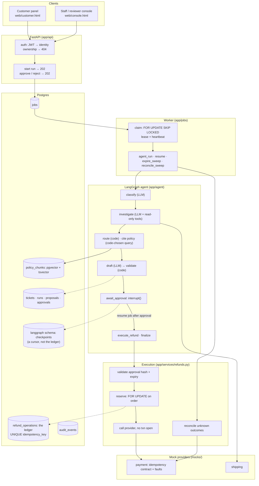
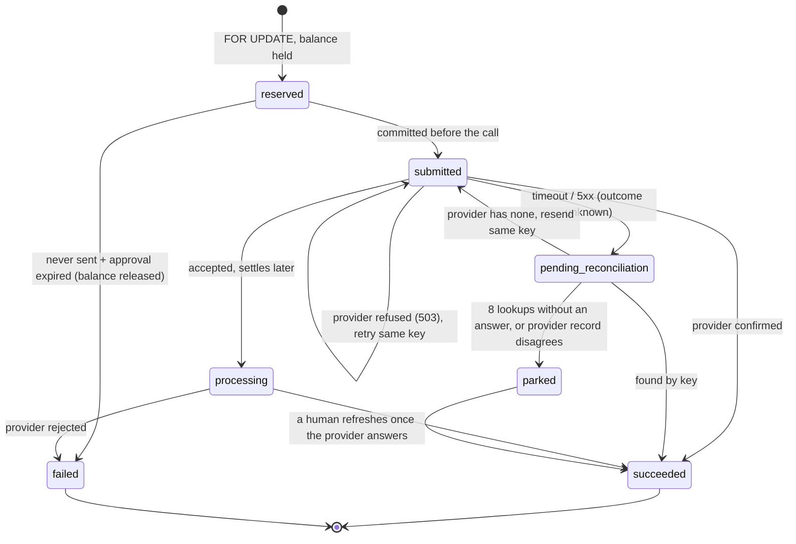

# Architecture

Three views of the system, then the table that matters most in a review: **where each design rule is enforced, and
which test proves it.**

## 1. Components



## 2. One refund, end to end

```mermaid
sequenceDiagram
    autonumber
    actor Asha as Asha (customer)
    actor Priya as Priya (staff)
    actor Ravi as Ravi (reviewer)
    participant API
    participant Q as jobs (Postgres)
    participant W as Worker
    participant G as Agent graph
    participant X as Execution
    participant P as Payment provider

    Asha->>API: POST /tickets (token → cus_asha; order ownership checked)
    Priya->>API: POST /staff/tickets/{id}/agent-runs
    API->>Q: run + job in one commit
    API-->>Priya: 202 Accepted + Location
    W->>Q: claim (SKIP LOCKED, lease)
    W->>G: stream graph (checkpoint after every node)
    G->>G: triage, read-only tools, code routes → propose_refund
    G->>G: draft → validate against fresh facts + own tool trace
    G-->>Ravi: proposal (code-built payload + hash), graph pauses: interrupt()
    Ravi->>API: approve {payload_hash} (four-eyes, hash must match)
    API->>Q: resume job
    API-->>Ravi: 202 Accepted
    W->>G: resume: re-read decision from the DB
    G->>X: execute_refund (idempotent per proposal)
    X->>X: re-check approval; reserve under FOR UPDATE; commit
    X->>P: create refund, Idempotency-Key: refund-<proposal_id>
    alt answer received
        P-->>X: succeeded
    else timeout / lost response
        X->>X: pending_reconciliation (never "failed")
        W->>P: reconcile sweep: find by key (resend only with the same key)
        P-->>W: succeeded
    end
    X->>API: ticket resolved
    Asha->>API: GET /tickets/{id}
    API-->>Asha: "completed by our payment provider" (confirmed state only)
```

## 3. The refund state machine (`refund_operations.status`)



`parked` is `needs_review_reason` set on a still-unknown status. It is never `failed`, because the money may have
moved. Only `failed` releases the held balance.

## 4. Where each rule is enforced

The 10 non-negotiable rules from `CLAUDE.md`, each with the code that enforces it and a test that fails if it breaks.

| # | Rule | Enforced in | Proven by |
| --- | --- | --- | --- |
| 1 | The model proposes, code disposes | `graph.route` (code picks the route); `domain/proposal_rules.validate_refund_draft`; `services/proposals.build_refund_payload` (code builds the payload) | `test_agent_workflow.py::test_model_suggestion_is_recorded_but_code_routes`, `test_proposal_rules.py::test_any_other_amount_is_rejected`, `test_agent_workflow.py::test_injection_does_not_change_the_route` |
| 2 | Identity only from auth; not-owned → 404 | `auth.get_current_customer`; `services/orders.get_owned_order` (every tool uses it); `ToolContext.customer_id` | `test_ownership.py::test_asha_cannot_see_vikrams_order`, `test_ownership.py::test_claiming_identity_in_text_changes_nothing`, `test_agent_tools.py::test_every_order_tool_checks_ownership` |
| 3 | Money is integer paise | `BigInteger` columns + `CHECK amount_minor > 0`; `PaymentClient.create_refund` refuses non-int | `test_eligibility.py`, `test_manual_resolution.py::test_held_amount_is_an_int_not_decimal`, `test_integration_clients.py::test_float_amount_never_leaves_the_client` |
| 4 | Every refund needs a stored approval bound to `payload_hash`; reviewer identified server-side | `services/approvals.approve` (hash, four-eyes, reviewer from the token); `refunds._validate_approval` (three-way hash match, expiry) | `test_manual_resolution.py::test_payload_edited_after_approval_is_refused`, `test_reviewer_roles.py`, `test_approval_restart.py::test_forged_resume_without_approval_executes_nothing` |
| 5 | Stable key, `FOR UPDATE`, commit before the call, reconcile unknowns, no txn across the network | `refunds._reserve` / `_send` / `refresh` / `reconcile_due`; UNIQUE `idempotency_key` | `test_refund_safety.py` (8-point matrix + real-thread races), `test_manual_resolution.py::test_no_transaction_open_during_provider_call` |
| 6 | Checkpoints aren't the ledger; side effects in a separate step | `graph.WRITER_NODES` + the `read_only` guard; `execute_refund` separate from `await_approval`; checkpoints in their own schema | `test_agent_workflow.py::test_read_only_guard_blocks_writes`, `test_worker_restart.py::test_worker_killed_inside_execute_refund_refunds_once` |
| 7 | Retrieved text and messages are untrusted | `prompts.wrap_customer_message`; policy queries chosen by code (`policy/queries.py`); UI renders text only | `test_agent_policy.py::test_injected_policy_text_is_data_and_changes_no_route`, `test_dev_and_ui.py::test_ui_never_writes_html_from_data` |
| 8 | Customer text states only confirmed facts; statuses stay distinct | `domain/customer_messages.customer_outcome` (built from stored refund status) | `test_eligibility.py::test_customer_text_never_claims_completion_early`, `test_refund_safety.py` (asserts "completed" never shows while unknown) |
| 9 | Every schema change is a migration | `migrations/versions/` (7 revisions); `alembic check` | `test_migrations.py::test_downgrade_then_upgrade_round_trips` |
| 10 | Synthetic data only | `scripts/seed_data.py`, `evals/cases/` (all invented); the report header disclaimer | `evals/reports/report.md` (first paragraph) |
